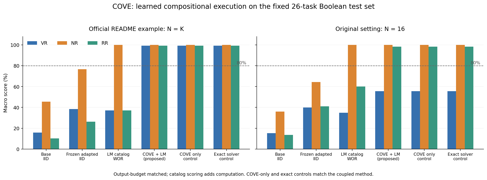
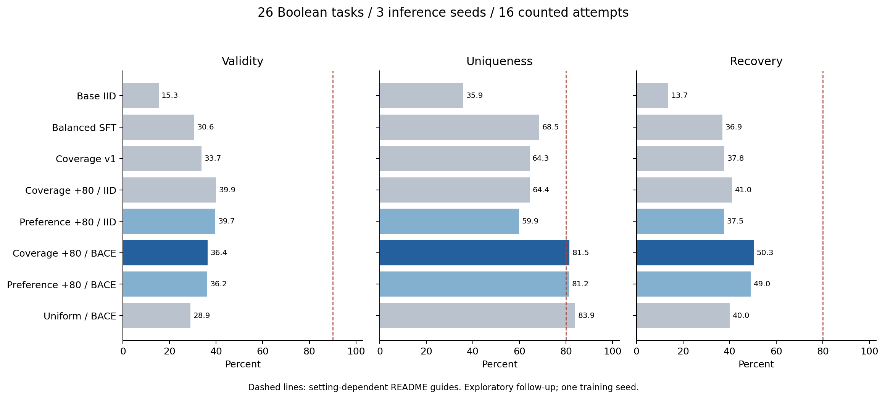
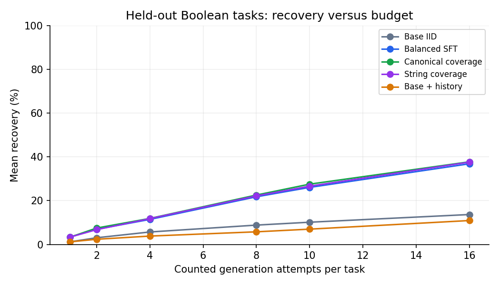
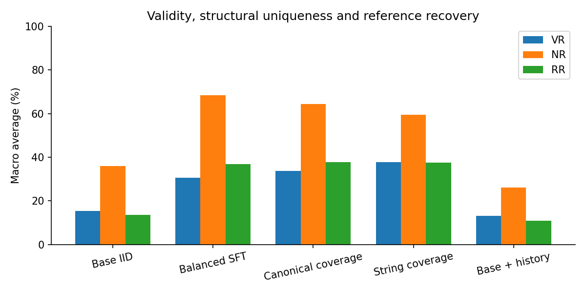
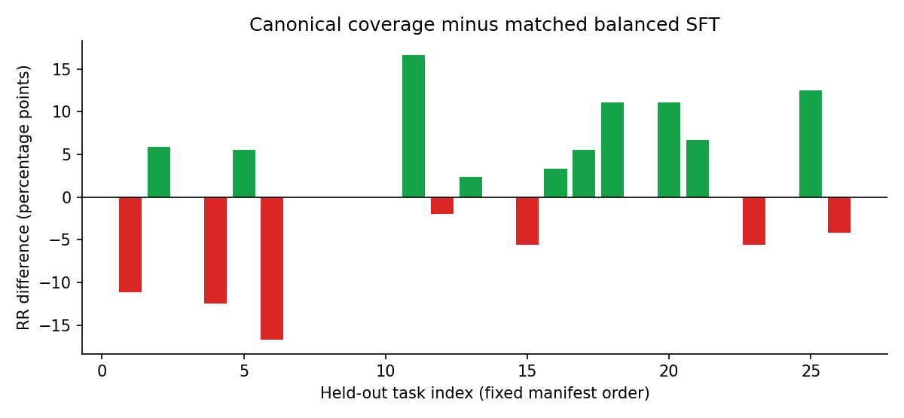

# Canonical Coverage LoRA: a controlled free-generation study

## 当前主线：固定预算的自由生成审计

项目现将研究贡献与高指标分开：主实验比较原始模型、同预算普通 SFT、结构覆盖训练和字符串覆盖消融，均为每题16次自由生成，不使用候选目录、强制去重、修复或根据参考答案数设置预算。正在按事前冻结协议补跑4,864次真实生成，包括26道已知观测题的新采样重复和12道全新三变量迁移题；结果无论正负均报告。

[本轮冻结协议](docs/RESEARCH_AUDIT_PROTOCOL_ZH.md)。原有 COVE 和 BACE 证据完整保留为历史补充；不能将目录选择的99%解释为LLM自由生成成绩。下方先前报告为历史记录，本轮完成后将更新主结果。

## 历史补充：COVE 目录选择实验

在 Mac 上新增训练 **179 参数的组合式神经执行器**，学习 AND / OR / NOT 的数值执行，再用观测一致性为冻结 LLM 的结构类别概率重新加权，以 Gumbel top-N 无放回采样输出。不是只换提示，也不在提议阶段调用精确布尔求解器。

**已完成：16 道训练题、6 道验证题、26 道测试题；三个执行器初始化、三个测试采样种子；18,981 条输出独立复核、35 项本地测试通过。** 仍是 x/y、深度 2 的受控 Boolean 子实验，未扩展成论文所有任务的评测。

### 当前最终结果：必须区分两种预算

下表是同一批测试题、每个协议内同一输出预算的宏平均，单位为百分比。N=K 使用[官方 README](https://github.com/CTT-Pavilion/_HypoSpace/blob/main/README.md) 示例 `--query-multiplier 1.0` 的预算规则；K 为该题完整参考集合大小，仅由评测器提供为预算。**N=K 的成绩不能直接当成旧 N=16 的提升。**

| Method | N=K: VR | NR | RR | N=16: VR | NR | RR |
|---|---:|---:|---:|---:|---:|---:|
| Base LLM / IID | 15.82 | 45.44 | 10.21 | 15.30 | 35.90 | 13.67 |
| Frozen coverage-adapted LLM / IID | 38.48 | 76.62 | 26.22 | 39.90 | 64.42 | 41.02 |
| LLM catalog / without replacement | 37.07 | 100.00 | 37.07 | 34.86 | 100.00 | 60.13 |
| **COVE + frozen LLM (primary)** | **99.27** | **100.00** | **99.27** | **55.53** | **100.00** | **98.28** |
| COVE only, no LLM prior | 99.27 | 100.00 | 99.27 | 55.53 | 100.00 | 98.28 |
| Uniform catalog / without replacement | 28.29 | 100.00 | 28.29 | 28.93 | 100.00 | 50.12 |
| Exact symbolic solver control | 99.27 | 100.00 | 99.27 | 55.53 | 100.00 | 98.28 |

原封存 BACE 版本在 N=16 下为 **36.38 / 81.49 / 50.34**。新方法在相同 N=16 下三项数值均提高；仅自适应预算实验实现三项 >80%。官方 README 的 Good Score 指引还要求 VR>90%，本次自适应子实验也达到该数值，但这不是课程分数、论文全榜成绩或基础 LLM 的原生生成水平。

**方法贡献与限制：** 相对使用同一 LLM 分数、同一目录、同一无放回规则的对照，学习执行模块提高合法覆盖；但是 COVE-only 和精确求解器已达到同样结果，尚无证据证明 LLM 先验提供额外最终指标收益。33 类静态目录的选择比自由生成更受限；NR=100% 由无放回设计保证，且在 N=K、合法命中均在参考集合时 VR=RR，三项不是三份独立机制证据。不能将系统成绩描述成“LLM 本身提升到 99%”。

候选评分每题额外评估 **66 个完整回答序列**，采用共享前缀和 9 个候选批次；各方法对齐的是最终输出预算，计算量没有对齐。执行器只读取原有训练标签，推理只读取给定观测；完整测试参考集合只用于预算与最终评分。详见[成本账本](results/all80/costs.json)。



[中文完整报告](docs/ALL80_RESULTS_ZH.md) · [English report](docs/ALL80_RESULTS_EN.md) · [算法与复现](docs/COVE_METHOD.md) · [原始对比数据](results/all80/test/summary.json) · [独立核验](results/all80/verification.json)

无需 LLM 或 GPU，使用下方 CPU 环境即可核验新结果：

```bash
.venv/bin/python scripts/verify_all80.py
```

**封存与版本：** 改动前的 BACE 版为提交 `fdb968e659545626e3275679d965ae29e1c408a5`，完整本地只读备份包含代码、模型、环境和运行证据；归档位置已经单独交付用户，私有归档不进入公开仓库。旧版所有实验、适配器和报告保留，下面均为历史结果，不能与本节预算混用。

## 历史版本：Canonical Coverage LoRA

在 Apple M5、24GB Mac 上实际完成的小模型课程研究：用经过校验的合法表达式训练 LoRA，并检验官方结构类别覆盖目标相对均衡 SFT 是否提供额外收益。

**第一版训练、验证与固定测试已完成。该段概述指第一版；新增优化见下节。** 基础模型为固定的四比特 Qwen2.5-1.5B-Instruct；使用 16 道训练题、6 道验证题、26 道测试题。正式生成共 6720 次，其中测试 6240 次。没有使用付费模型 API。

English summary: This project studies parameter-level coverage adaptation for a frozen quantized language model on a task-derived HypoSpace Boolean subset. It compares matched LoRA training objectives and a practical history baseline. Results are small-model, held-out-observation evidence, not a reproduction of the paper's model scores or a claim of globally new diversity training.

[English method](docs/METHOD.md) · [English results](docs/RESULTS_EN.md)

<!-- OPTIMIZATION_UPDATE_BEGIN -->
## README 参考指标优化：新增实测结果

新增结构类别偏好训练对照与 BACE 预算控制，原始结果完整保留。**验证选定的 Coverage +80 / BACE：VR 36.38%、NR 81.49%、RR 50.34%**。不重复率超过 README 的 >80% 指引；其余指标以实际表格为准，不能据此宣称三项全面达标或课程高分。

验证规则选定 Coverage +80 / BACE；选定方法在测试前冻结。

实际选用继续覆盖训练 80 步＋BACE；新增偏好项没有通过验证选择，保留为未选用的对照实验。 跟进测试仍满足相对第一版的数值保护条件。

同检查点 BACE 相对 IID：Validity -3.53、Uniqueness +17.07、Recovery +9.32 个百分点。NR 的 95% 区间 [+13.54, +20.67]，RR 的区间 [+5.90, +12.82]。这项对照检验解码模块本身，额外训练不能归因给 BACE。

| Method | Validity | Uniqueness | Recovery |
|---|---:|---:|---:|
| Base IID | 15.30% | 35.90% | 13.67% |
| Balanced SFT | 30.61% | 68.51% | 36.86% |
| Coverage v1 | 33.73% | 64.34% | 37.76% |
| Coverage +80 / IID | 39.90% | 64.42% | 41.02% |
| Preference +80 / IID | 39.66% | 59.86% | 37.52% |
| Coverage +80 / BACE | 36.38% | 81.49% | 50.34% |
| Preference +80 / BACE | 36.22% | 81.25% | 48.96% |
| Uniform / BACE | 28.93% | 83.89% | 40.03% |


两组新训练各增加 80 步，同起点、同数据、同预算。完整跟进测试仍是 26 题×3 种子×16 次，沿用第一版评分方式；已见过这些测试观测，因此结果属于探索性跟进。

**新增损失相对同解码的匹配继续训练：VR -0.16 个百分点，95% 区间 [-2.16, +2.00]。** 新增偏好损失相对匹配继续训练的额外合法率优势尚未获得清晰支持。

[详细中文报告](docs/OPTIMIZATION_RESULTS_ZH.md) · [English results](docs/OPTIMIZATION_RESULTS_EN.md) · [训练原理](docs/CANONICAL_PREFERENCE.md) · [BACE 原理](docs/BACE_METHOD.md) · [原始对比数据](results/canonical_preference_v5/test/summary.json)



旧版演示稿和下方原始表报告第一版；讲解新增优化请使用本节和新增报告。

新增复核与复用：

```bash
.venv/bin/python scripts/verify_optimization.py
.venv/bin/python scripts/restore_preference_adapters.py
# 完成下方 Apple Silicon 固定模型环境后，可重新生成新适配器的验证结果：
../runtime/mlx-env/bin/python -m explorer.preference_experiment validation
```

[新版英文两页展示与两分钟讲稿](docs/BACE_PRESENTATION_EN.md) · [新版组内对齐配置](results/optimization_group_packet.json)。同检查点 BACE 相对无 LLM 均匀控制的 RR 增加 10.31 个百分点，95% 区间 [5.36, 15.23]；模型对合法覆盖的作用与强制唯一率分开检验。

<!-- OPTIMIZATION_UPDATE_END -->


## 第一版测试结果（保留）

每题生成 16 次，三个随机运行编号 17/29/43，先按题和运行算指标，再宏平均。失败、重复和不合规答案都保留在调用预算内。

| 方法 | VR 合法率 | NR 结构唯一率 | RR 参考覆盖率 | 平均每题推理秒数 |
|---|---:|---:|---:|---:|
| 原始模型 / Base IID | 15.30% | 35.90% | 13.67% | 9.64 |
| 均衡 SFT | 30.61% | 68.51% | 36.86% | 9.33 |
| 结构类别覆盖 LoRA | 33.73% | 64.34% | 37.76% | 9.63 |
| 字符串覆盖消融 | 37.82% | 59.54% | 37.61% | 9.85 |
| 原始模型＋历史 | 13.06% | 26.20% | 10.92% | 10.99 |

官方 README 的 Good Score 指引为 **Validity >90%、Uniqueness >80%、Recovery >80%**。本次结构类别覆盖模型的三项绝对指标均未达到这些参考值。这里展示的是相对本项目原始模型的改善，不能据此称为模型性能已经优秀。这些指引不是课程分数或合格线，详见[官方指标参考与本项目范围](docs/BENCHMARK_SCORE_GUIDANCE_ZH.md)。

结构类别覆盖相对原始模型的 RR 差为 **+24.09 个百分点**；相对均衡 SFT 为 **+0.89 个百分点**，按题配对 bootstrap 的 95% 区间为 **[-1.97, +3.72] 个百分点**，VR 差为 **+3.12 个百分点**。结构类别覆盖的平均 RR 较高，但配对区间跨零，额外优势尚不确定。

相对字符串覆盖消融的 RR 差为 **+0.14 个百分点**，区间 **[-4.86, +4.97]**。结构类别合并的平均 RR 高于字符串覆盖，但区间跨零，模块贡献仍不确定。

预先提出的实际采用门槛是相对 SFT 的 RR 增加至少 5 个百分点且 VR 下降不超过 2 个百分点；它不是显著性检验或效果承诺。本次未达到该数值门槛，保留为研究结果，不据此宣称覆盖目标是确定胜出的方案。 不要仅凭超过原始模型就宣称覆盖损失有效。

- [完整测试汇总](results/final/test/summary.json)与[逐题及运行结果](results/final/test/episodes.csv)。
- [验证结果](results/final/validation/summary.json)，与最终测试明确分开。
- [核验记录](results/final/verification.json)及[组内比较包](results/final/group_comparison_packet.json)，含 RR@10 和固定配置。
- [压缩原始测试证据](results/final/test/evidence.jsonl.gz)：每次提示、观测、原回答、种子、用量与评分。
- [参考集合外校验通过项](results/final/test/out_of_reference.json)及[原始私有轨迹哈希](results/final/test/raw_manifest.json)。







图表同时提供独立 PDF 文件，可用于小组视频和报告。预算 10 的结果也包含在汇总中，不能在未对齐题目和模型时与同组截图直接排名。

## 课程要求与研究定位

老师 Part 1.2 占总评 30%，要求设计新颖 ML 方法改善 HypoSpace 上的 LLM 表现，方法自由；按 novelty、importance、quality 评分，最终提交十分钟小组视频和公开 GitHub 仓库，每位成员讲解，全组同分。

本仓库交付源码、真实适配器、原始记录、对照、消融、分析、复现说明及[视频录制提纲](docs/VIDEO_GUIDE_ZH.md)。**视频尚需组员实际参与录制，仓库和提纲不能替代视频。** 代码中的 NR 是结构唯一率，与课程创新性评分不是同一个概念。

拟研究贡献是把官方 mechanistic key、有限别名覆盖下界和合法性学习结合到适配器训练，并在同训练预算下验证它的作用。LoRA、均衡训练和期望覆盖公式不是首次提出；已有 GAPO 等多样性训练工作需要正常引用。

## 方法与对照

每道训练题枚举兼容参考类别；仅保留通过共同校验的表达式和固定外层括号格式变体，构成每类最多两个完整回答。训练器只读取训练题标签。当前有效目标为 143 个题目与类别配对、286 条写法，另有六个配对没有可用合法写法。所有回答保留真实结束 token，提示与填充不参与交叉熵。

设 A_k 为类别 k 的有限完整回答事件，p(y|O) 为包含结束 token 的序列概率：

```text
p_tilde[k] = sum(p(y | O) for y in A_k)
C_16 = (1/K) * sum(1 - (1 - p_tilde[k])**16)
L = balanced_SFT_loss - C_16
```

固定提示独立采样时，有限互斥完成事件提供期望参考覆盖下界；它不是所有可能写法的完整类别概率，也不适用于动态历史的独立同分布解释。p(y|O) 来自 token 对数概率求和，不能使用平均 token 概率，也不在合法候选池中重新归一化。

训练先做 80 步共享 SFT 预热，再复制参数和 Adam 状态给三个各 120 步的分支：均衡 SFT、类别覆盖、字符串覆盖。每个最终适配器有相同的 200 步训练路径；分支使用匹配的样本顺序、有效批量和学习率。字符串消融分别奖励写法，保留相同分母与 SFT 权重，检验类别合并的作用。

配置：rank 8，MLX scale 16，dropout 0，最后八个 transformer block 的 q/v 投影，学习率 1e-4，梯度检查点，每次更新四个类别组、共八条回答。温度 1、top-p 1、关闭 top-k/min-p 和重复惩罚、最多 128 输出 token。

这是离线参数训练，主方法测试只读取原始观测与任务规则。它不采用 DCHG 的未观测输入选择、指定预测差异、历史条件构造或修复循环。固定括号变体只是训练编码；详细说明见[方法文档](docs/METHOD.md)和[组内比较协议](docs/GROUP_COMPARISON_ZH.md)。

## 数据与评分边界

使用上游布尔 x/y、AND/OR/NOT、深度 2 的规则构造受控题目。固定环境枚举到 34 个参考结构类别；从一至三条观测、至少四个兼容类别的规则得到 48 个观测题。按内容固定划分为 16/6/26，见[清单](results/coverage_plan/split_manifest.json)。这是任务规则派生子实验，不是论文所有题目、任务域和模型的复现。

不同观测题可以共享表达式结构，结论只涉及未见观测条件，不是未见表达式家族或跨域泛化。官方结构规则不额外使用吸收律、分配律或德摩根律合并表达式。

- VR：符合共同解析、空间和观测规则的尝试比例。
- NR：不同的空间内 mechanistic key 数除以全部尝试数，可能包含违反观测的结构。
- RR：不同合法参考类别命中数除以该题完整参考集合大小。

共同评分保留上游枚举分母，并增加一致的解析/空间先行拒绝检查。上游存在双向生成器与校验器差异：某些参考写法被拒绝，某些校验通过结构不在枚举中。训练目标先验证，参考外输出单列，所有方法使用同一口径；没有把修复评分算作方法提升。绝对成绩不与论文表格直接排名。

固定测试为 26×3×5×16=6240 次；验证为 6×1×5×16=480 次。共享预热与各分支的计算开销另行记录。主四组固定提示；第五组使用完整历史，是不同的实用采样策略。主要区间以题为重采样单位，三个运行先在题内平均，不能把全部输出当成独立题目。三个种子指推理随机性，不代表三次独立的适配器训练；训练种子只有 4300。

覆盖目标本身也会增加合法答案的概率质量，因此 RR 上升不能自动解释为更均匀的长尾分布。另提供[匹配合法命中数的探索性分析](results/final/test/matched_validity_exploratory.json)，从实际输出等量抽取参考内合法命中，比较期望去重覆盖。纳入 75/78 组配对输出，零共同命中情况被排除；覆盖方法相对 SFT 的 RR 差为 **-0.77 个百分点**。这个诊断也未提供额外多样性收益的支持。它是事后诊断，不替代主要同调用预算比较。

## 已测资源与训练真实性

[训练汇总](results/final/training_summary.json)记录 trainable parameters、预算、冻结检查和峰值内存；[训练日志](results/final/training_log.jsonl)逐步记录目标值和耗时；[生成账本](results/final/generation_ledger.json)记录调用和 token。[源文件记录](results/final/source_manifest.json)固定执行时的代码和数据哈希。

适配器参数数量为 **311,296**，训练峰值 MLX 内存约 **2.12GB**。共享预热与三个分支共执行 **440 次更新**，训练循环累计约 **32.5 分钟**，不含下载、准备和评估。基础张量逐一检查未改变，适配器检查为已改变。不同分支优化的目标值定义不同，不能直接用它们的 loss 大小比较性能。

早期另有 256 次控制器试跑和 96 次原始验证诊断，不纳入正式统计。旧控制器保留为历史原型，其文档不是当前结果的复现入口。

## 无 GPU 核查公开结果

```bash
python3.12 -m venv .venv
.venv/bin/python -m pip install -r requirements-lock.txt
.venv/bin/python scripts/verify_results.py
```

该脚本取得校验过的上游文件及全题库缓存，重新解析、校验公开原始回答，检查逐题汇总与 VR/NR/RR。它不调用 LLM、不需要 API 密钥或 GPU。

## 在 Apple Silicon 上完整复现

```bash
python3.12 -m venv ../runtime/mlx-env
../runtime/mlx-env/bin/python -m pip install -r requirements-mlx-lock.txt
../runtime/mlx-env/bin/python -m explorer fetch
../runtime/mlx-env/bin/python -m explorer prepare
HF_HOME=../runtime/hf-cache ../runtime/mlx-env/bin/python scripts/local_mlx.py --download-only
../runtime/mlx-env/bin/python -m unittest discover -s tests -v
../runtime/mlx-env/bin/python scripts/restore_training_targets.py
../runtime/mlx-env/bin/python -m explorer.coverage_lora train
../runtime/mlx-env/bin/python -m explorer.coverage_lora validation
../runtime/mlx-env/bin/python -m explorer.coverage_lora test
../runtime/mlx-env/bin/python -m explorer.final_report
../runtime/mlx-env/bin/python scripts/plot_final.py
../runtime/mlx-env/bin/python scripts/verify_results.py
```

`explorer prepare` 生成全部 48 题缓存，正式 runner 使用冻结的 16/6/26 清单覆盖旧原型划分。`restore_training_targets.py` 从公开压缩文件还原执行时的完整训练 token，并核对训练前哈希；这避免上游等价表达式的代表写法顺序影响复现。另可用 `explorer.coverage_lora prepare` 重新构造合法目标池，但完整复现应采用冻结目标。权重按固定 Hugging Face 修订下载并校验 SHA256，不启用远程代码。完整复现不需要 HTTP 服务或 `.env`。

训练防止覆盖已有日志；在新克隆目录复现或先归档旧运行。生成逐条断点恢复，并核对方法、配置和步骤。`runs/final_v1` 是私有运行目录，公开的证据和适配器已经单独导出。固定种子不保证跨芯片、系统或库版本逐位相同。

跳过重新训练时，在新克隆中仅准备环境、题库缓存和基础模型，直接运行 `python scripts/restore_adapters.py`（不要先还原训练目标到运行目录），将公开适配器恢复到空运行目录，再执行 validation/test。原始基础权重不在仓库内，体积约 869MB。

查看不重新推理的固定验证题演示：`python scripts/show_demo.py`。

## 文件入口与发布

- `explorer/coverage_lora.py`：数据、掩码、训练和直接 MLX 评估。
- `explorer/final_report.py`：完整性检查、指标、预算曲线和配对区间。
- `explorer/experiment.py`、`upstream.py`：共同校验及固定版本加载。
- `artifacts/adapters/`：三个最终 LoRA、配置、许可证及哈希。
- `results/final/`：本次真实结果、原始压缩证据和图表。
- `scripts/verify_results.py`：独立 CPU 核查入口。
- `docs/`：方法、视频提纲、历史方案和组内对比说明；`ci_example.yml` 是可选 CI 模板。

源码使用 MIT；适配器的基础模型为 Apache 2.0，见 [NOTICE](NOTICE.md) 和适配器目录许可证。不要上传 `.env`、完整模型、环境、缓存、校内制度文件和账户信息。临时工作放父目录 `.work`，本次结束后清理；模型缓存和可复现运行按用途保留。

同组 DCHG 的实际模型、题目和修复计数尚未取得，未把其截图分数冒充共同测试结果。公开项目由 GitHub 账号 Xiao-ada 维护；每位组员在视频中的实际贡献需由小组填写。

## 参考文献

- Chen et al. [HypoSpace, ICML 2026](https://proceedings.mlr.press/v306/chen26bz.html)；[官方代码](https://github.com/CTT-Pavilion/_HypoSpace)。
- Anschel et al. [GAPO, EMNLP 2025](https://aclanthology.org/2025.emnlp-main.1649/)。
- Fan et al. [Prefix-conditioned SFT](https://aclanthology.org/2026.acl-long.9/)。
- [MLX LM LoRA](https://github.com/ml-explore/mlx-lm/blob/main/mlx_lm/LORA.md)。
- [Qwen2.5-1.5B-Instruct](https://huggingface.co/Qwen/Qwen2.5-1.5B-Instruct)；固定转换版本见 model.local_mlx.lock.json。

## 后续机制诊断

第一版之后补做了仅使用训练样本的只读梯度探针和有限语法写法审计，未修改模型、测试结果或生成调用数。采样点上的覆盖梯度与 SFT 高度同向；训练类别在有限语法池中的合法写法数为 1–50，第一版每类固定使用两个写法。诊断提供新的研究方向，尚不证明额外性能收益。见[诊断证据与下一步实验](docs/NEXT_EXPERIMENT_ZH.md)。

## 已完成版本的独立贡献审查

[贡献审查与可直接使用的报告陈述](docs/CONTRIBUTION_AUDIT_ZH.md)整理了已有工作的定位、目标的数学性质和匹配对照证据。对现有结果补做的探索性次要推断显示：相对匹配 SFT，VR 增加 3.125 个百分点，同时 NR 降低 4.167 个百分点；RR 的额外优势仍未证实。全部四个对照、三个最终指标统一纳入十二项比较，保留代价与不确定性。次要推断不是新的预注册确认性结果，也不证明全球首创。

无需训练或 GPU 可复核：`.venv/bin/python scripts/verify_contribution_audit.py`。第一版原始主结果、模型和 6720 次正式生成记录保持不变；新增的偏好训练与解码实验单独保存，不会覆盖第一版。

## 个人两至三分钟讲解

按各成员分别介绍自己方法的分工，已准备[中文说明、主讲稿、精简稿、两页内容和问答](docs/PERSONAL_TALK_ZH.md)，以及[英文备选稿](docs/PERSONAL_TALK_EN.md)。[全组视频指南](docs/VIDEO_GUIDE_ZH.md)给出三人或四人组的十分钟分配参考。稿件时长为估算，实际视频仍需成员试读和录制。

第一版个人口头稿：[两分钟以内，含问题来源、GAPO 文献启发、方法与最终成果](docs/PERSONAL_TALK_2MIN_ZH.md)。

[Editable principle and results slides](presentations/personal_method_results.pptx), with [page previews](presentations/README.md).
