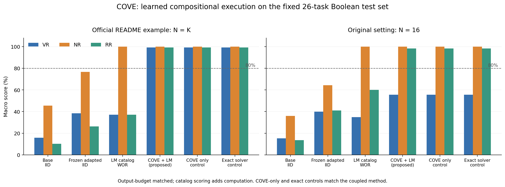

# COVE: final three-metric follow-up

The new structured system reaches **99.27% validity, 100% uniqueness and 99.27% recovery** on the fixed 26-task Boolean test subset under the official README example's adaptive output budget N=K. This is a frozen-LLM-assisted catalog-selection system, not the raw language model's unrestricted generation accuracy.

The previous BACE version was frozen before this work, at commit `fdb968e659545626e3275679d965ae29e1c408a5`. Its complete local read-only snapshot includes the project, model, environments and evidence. Historical public results remain unchanged.

## Two protocols, reported separately

We retain the original 16/6/26 train/validation/test observation-task split, x/y variables and depth-2 AND/OR/NOT syntax. The primary executor initialization 4306 and energy coefficient 10 were fixed before validation; two additional initializations replicate training. All three obtain the same reported metrics. The three inference seeds are 17,29,43; they are not independent LLM retrainings.

Percentages below are macro averages over task/seed episodes. Each protocol gives all methods the same output budget. Candidate scoring adds computation, so this is not a FLOPs-matched comparison.

| Method | N=K: V | U | R | N=16: V | U | R |
|---|---:|---:|---:|---:|---:|---:|
| Base IID | 15.82 | 45.44 | 10.21 | 15.30 | 35.90 | 13.67 |
| Frozen adapted IID | 38.48 | 76.62 | 26.22 | 39.90 | 64.42 | 41.02 |
| Frozen LLM catalog, without replacement | 37.07 | 100.00 | 37.07 | 34.86 | 100.00 | 60.13 |
| **COVE + frozen LLM** | **99.27** | **100.00** | **99.27** | **55.53** | **100.00** | **98.28** |
| COVE only | 99.27 | 100.00 | 99.27 | 55.53 | 100.00 | 98.28 |
| Uniform catalog, without replacement | 28.29 | 100.00 | 28.29 | 28.93 | 100.00 | 50.12 |
| Exact symbolic solver control | 99.27 | 100.00 | 99.27 | 55.53 | 100.00 | 98.28 |

The frozen BACE system scored 36.38/81.49/50.34 at N=16. The new system improves those scores by 19.15/18.51/47.94 percentage points at the same N=16. Its fixed-budget validity is still below 80%.

The additional N=K experiment follows the official README's `--query-multiplier 1.0` example, with K=5–20 here. The harness supplies K only as a common budget, not the compatible class identities. It is not a silent change to the old experiment. Inside the intended reference space, `U <= K/N + 1 - V`; at original N=16, mean K=9.1923 implies macro U≤77.45% if macro V≥80%. Upstream out-of-reference parser/enumerator artifacts are not used to evade this bound.

## What the evidence supports

COVE learns shared AND/OR/NOT numerical execution modules with 179 parameters using only the original training labels, then combines learned observation consistency with represented-alias LLM probabilities. Gumbel top-N selects unique structural classes. No exact solver or test reference membership enters the learned proposal. The three training runs take 37.21 seconds together, excluding previous LoRA training.

Against the same LLM catalog sampler with COVE removed, adaptive V and R improve by **62.20 pp**, with descriptive task-paired bootstrap 95% intervals **[53.41,70.86] pp**. Inference seeds are averaged within each of 26 tasks. These are exploratory follow-up intervals on previously reported test observations, not fresh confirmatory or multiplicity-adjusted evidence.

**COVE-only and the exact solver match the coupled method. The experiment therefore demonstrates learned consistency's contribution over LLM catalog scoring, but no incremental final-metric benefit from the LLM prior.** Uniqueness is guaranteed by class sampling without replacement. At N=K and with all valid hits inside the reference set, V=R; the three headline metrics are related, not independent gains.

Validation scores were 95.37/100/95.37. The static training-derived inventory covers 33 of the 34 official structural classes. The missing NOR class affects three test tasks; the full reference denominators remain unchanged. All proposed catalog outputs avoid the known out-of-reference validity artifacts. Exact Boolean solving already works well in this small domain, limiting the research necessity of the neural/LLM combination.

## Cost and verification

Each task evaluates 66 complete candidate strings including EOS, in nine candidate batches with a shared prompt prefix. The 32 validation/test tasks require 2,112 sequence scores, taking 68.59 seconds in total. Scores are reused across inference seeds and controls. This extra computation is explicit; catalog selection is not equivalent to N unrestricted autoregressive generations.

Existing genuine IID prefixes are replayed unchanged, with 42 genuine extra generations for tasks with K>16. All outputs count, including invalid ones, with no hidden repair or rejection. CPU verification independently reconstructs rankings and re-scores **18,981** outputs, including replay and deterministic selections; these are not 18,981 newly generated LLM responses. All 35 local tests pass. The common fail-closed parser/space gate is retained across methods and differs slightly from the monolithic upstream runner, preventing direct paper-leaderboard comparisons.

A separate frozen-executor probe tests 1,024 unique depth-3–6 programs with actual semantic dependence on held-out z, across all eight inputs. All three executors achieve 100% output and full-program accuracy. Leaf-variable mappings are supplied; this is an auxiliary operator-composition probe, not a three-variable LLM HypoSpace result.

The study remains a small, known-structure, exploratory Boolean subset. It does not establish unseen-family, cross-domain or open-ended generation improvements, nor guarantee course grades. The group's required video still needs to be recorded.

See [method and primary references](COVE_METHOD.md), [raw summary](../results/all80/test/summary.json), [verification](../results/all80/verification.json), [cost ledger](../results/all80/costs.json), and [paired differences](../results/all80/paired_differences.json). CPU replay: `.venv/bin/python scripts/verify_all80.py`.
