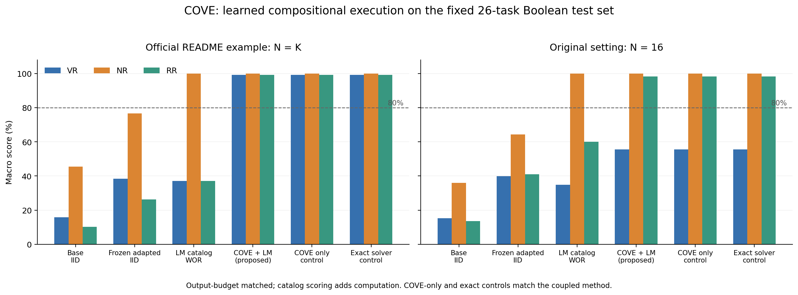

# 三指标优化结果：COVE

本轮在封存 BACE 版本后完成。新增组合式神经执行器和有限结构目录采样，完整测试已结束，**自适应预算下宏平均 VR=99.27%、NR=100%、RR=99.27%**。这是学习执行器辅助的结构选择系统的结果，不是基础 LLM 自由生成的原生成绩。

## 备份和范围

原版提交为 `fdb968e659545626e3275679d965ae29e1c408a5`，方法为 Coverage continuation +80 / BACE。已另存只读完整本地归档，含代码、历史、运行证据、环境与固定基础模型，24,982 个条目、约 1.76GB。具体本地目录已交付用户；该私有备份不会上传 GitHub。原版公共结果仍在 `results/canonical_preference_v5/`。

继续使用原来的布尔规则子实验：x/y、AND/OR/NOT、深度 2；16 道训练题、6 道验证题、26 道测试题。每题给出部分输入/输出观测，任务是恢复所有兼容的结构假设。这里没有切换到其他任务域，也没有获得同组 DCHG 的可复核配置，所以不能按其截图分数直接排名。

## 为什么单列自适应预算

原实验每题 N=16。对本测试集，平均参考假设数 K=9.1923。在合法答案均属于预期参考空间的条件下：`NR <= K/N + 1 - VR`。因此原设置中若宏平均 VR≥80%，宏平均 NR 至多 77.45%，三项同时超过 80% 不可行。上游校验与枚举之间的实现差异不作为规避该限制的手段。

新增协议采用官方 README 布尔例子的 `--query-multiplier 1.0`，即 N=K，测试题预算范围为 5–20。每种方法接收相同预算；参考集合的具体成员不进入学习提议。**这是增加一种公开允许的预算设置，并不是把旧实验的分母改掉。** 两套协议都完整报告。

## 测试对比

单位为百分比，按题/推理种子先计算，再宏平均。主执行器种子 4306 在验证前固定；4307/4308 是独立初始化复测，三者最终表格一致。每个执行器共享原有冻结 LLM；这不代表三次 LLM 微调。

| 方法 | N=K VR | NR | RR | N=16 VR | NR | RR |
|---|---:|---:|---:|---:|---:|---:|
| 原始 LLM 独立采样 | 15.82 | 45.44 | 10.21 | 15.30 | 35.90 | 13.67 |
| 冻结继续覆盖训练模型 / 独立采样 | 38.48 | 76.62 | 26.22 | 39.90 | 64.42 | 41.02 |
| 同模型目录评分＋无放回 | 37.07 | 100.00 | 37.07 | 34.86 | 100.00 | 60.13 |
| **COVE＋冻结 LLM** | **99.27** | **100.00** | **99.27** | **55.53** | **100.00** | **98.28** |
| 仅 COVE，无 LLM 因子 | 99.27 | 100.00 | 99.27 | 55.53 | 100.00 | 98.28 |
| 均匀目录无放回 | 28.29 | 100.00 | 28.29 | 28.93 | 100.00 | 50.12 |
| 精确符号求解对照 | 99.27 | 100.00 | 99.27 | 55.53 | 100.00 | 98.28 |

封存版 BACE 的 N=16 指标为 36.38 / 81.49 / 50.34。新系统在同一 N=16 设置下分别增加 **19.15 / 18.51 / 47.94 个百分点**。只有自适应预算下三项均超过 80%；原 N=16 的合法率仍未超过 80%。

## 学习模块是否有独立贡献

关键对照保留相同冻结 LLM、33 类目录、无放回规则和输出预算，只去掉神经执行一致性项。N=K 下加入 COVE 后，VR、RR 均增加 **62.20 个百分点**；按 26 道题配对 bootstrap 的描述性 95% 区间均为 **[53.41,70.86] 个百分点**。三个推理种子先在题内平均，不能将每个输出当成独立题目。这是已见测试观测上的探索性跟进区间，未作为多重比较校正后的确认性发现。

但仅执行器和精确符号对照与主系统同分，因此证据支持的是“学到的执行一致性模块相对 LLM 目录评分改善合法覆盖”，**不支持“LLM 先验在执行器基础上继续提高最终指标”**。无放回直接保证 NR=100%；N=K 且合法命中均在参考集合内时 VR=RR，不能把三列当成三项独立的机制突破。

验证集主方法为 95.37 / 100 / 95.37，未用测试结果选择种子或调节系数。原来的 LLM 覆盖损失相对普通 SFT 的增益仍按历史报告保留，不因为新模块的成绩而改写。

## 具体做法

1. 从原 16 道训练题的合法目标收集 33 个结构类别和固定别名，利用公开语法选定对应表达式树；对所有测试题使用同一目录。
2. 用共享 AND、OR、NOT 小网络递归执行表达式，只有 **179 个参数**。采用训练观测标签和训练题/类别兼容标签学习；数值真值表没有写进神经前向函数。
3. 冻结原来的 Qwen2.5-1.5B 四比特模型及继续覆盖训练适配器，为每类的两个完整回答打分。
4. 将 LLM 类别对数质量与 `10 × 学习到的观测一致性对数得分` 相加，再用 Gumbel top-N 无放回选择结构。提议不调用精确校验器；精确符号执行只用于单独基线和评分核查。

这是能量重加权 / 专家乘积，不应称作精确贝叶斯后验。其理论依据是组合式共享神经模块与无放回采样；具体公式、文献和复现步骤见 [COVE 方法](COVE_METHOD.md)。与同组 DCHG 的“选择未观测输入、指定预测差异、引导新生成”不同。

## 成本、核验和剩余误差

- 三个执行器训练合计 **37.21 秒**；每个 2,000 步。旧 LoRA 训练成本另计。
- 32 道验证/测试题共评分 2,112 个候选完整回答，约 **68.59 秒**；每题 66 个、9 个批次，含共享前缀处理。评分在采样种子间复用。这些额外评分不能伪装成只花 N 次自由生成。
- 基线复用原来的真实 16 步前缀；对 K>16 的测试题真实补生成 **42 次**。所有结果保留，未修复、未免费过滤。
- 验证 1,296 条＋测试 17,685 条输出独立重算通过；其中包含基线重放与目录选择，不是 18,981 次新 LLM 调用。35 项本地测试全部通过。
- 同一共同解析/空间门控、完整参考集合分母用于所有方法；原始基线存在参考外校验通过项，已单列，新目录方法未利用这些项。
- 目录比完整枚举少一个 NOR 结构类，涉及三道测试题；没有从 RR 分母中移除。自适应预算下也因此未到 100%。固定 16 次时 K>16 还会存在预算截断。
- 另外对 1,024 个不同的深度 3–6、真正依赖 z 的程序检查全部 8 种输入，三个执行器均为 100% 数值执行正确率。这只是冻结算子网络的辅助组合泛化探针；输入变量映射由外部提供，不是三变量 LLM 基准成绩。

高指标的主要边界：目录较小、变量/算子规则明确、结构在训练中出现过、精确求解器已经足够强。方案的工程完整性较高，但这些事实限制研究必要性和新颖性；不能据此承诺课程高分，更不能声称在全 HypoSpace 上达到 99%。课程另需全组录制视频。

## 文件和复核入口

- [实际测试汇总](../results/all80/test/summary.json)与[逐题结果](../results/all80/test/episodes.json)。
- [压缩原始测试输出](../results/all80/test/evidence.jsonl.gz)。
- [独立复核](../results/all80/verification.json)、[成本](../results/all80/costs.json)、[配对差异](../results/all80/paired_differences.json)。
- [执行器权重与训练记录](../results/all80/executor_training_summary.json)、[冻结选择记录](../results/all80/selection.json)、[剩余误差范围](../results/all80/scope_audit.json)。
- [训练入口](../explorer/learned_executor.py)、[提议与实验](../explorer/all80_experiment.py)、[CPU 复核脚本](../scripts/verify_all80.py)。

CPU 复核：`.venv/bin/python scripts/verify_all80.py`。绘图和完整 MLX 复现的环境要求见方法文档。
