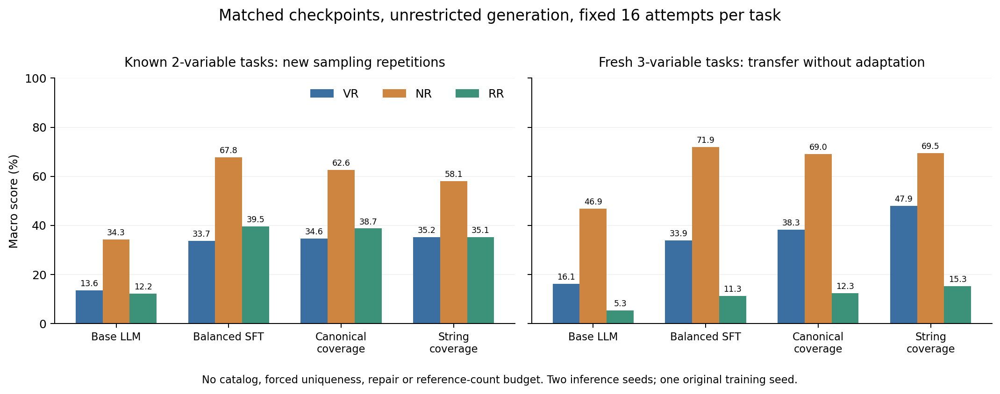
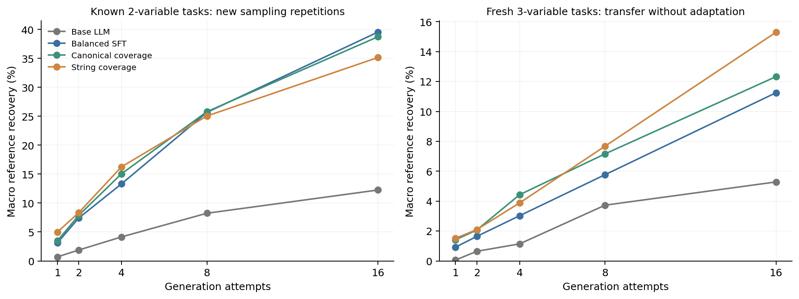

# Fixed-budget free-generation audit

The revised project tests a task-specific coverage objective, without a minimum score target. The protocol was frozen before new outputs in commit `f6ab465`. Four methods produce **4,864 genuine new LLM responses**, with no replay, candidate catalog, forced uniqueness, rejection sampling or repair.

## Known two-variable tasks: fresh sampling repetitions

All original matched 200-update checkpoints are retained: 80 shared SFT warmup updates plus 120 branch updates. No new checkpoint selection or training occurs. The 26 observation tasks were previously used; only sampling randomness is fresh, with seeds 18617/28657. Common prompt formatting defects are corrected for all arms, so these scores must not be spliced into the old-prompt table.

| Method | VR | NR | RR | Recovered classes / task |
|---|---:|---:|---:|---:|
| Base LLM | 13.58% | 34.25% | 12.25% | 1.23 |
| Balanced SFT | 33.65% | 67.79% | 39.54% | 3.60 |
| Canonical Coverage | 34.62% | 62.62% | 38.73% | 3.48 |
| String Coverage | 35.22% | 58.05% | 35.15% | 3.15 |

**Primary predeclared comparison, canonical coverage minus matched SFT RR@16: -0.81 pp, 95% CI [-4.33, +2.69] pp. The interval crosses zero: additional recovery over matched SFT is not established, which also does not prove equivalence.** Base-relative improvement cannot all be attributed to the new coverage term. The string-coverage ablation remains visible regardless of which column looks better.

## Fresh three-variable transfer tasks

Twelve observation tasks are selected by a fixed salted hash before any model runs: four each with one, two or three observations. The official depth-2 Boolean grammar is used to derive this project extension. Its 125 structural classes include 91 absent from the two-variable space. Models receive no transfer adaptation. Only one selected task strictly requires a class absent from the old space; the others also allow old structures as some valid answers. This is an expanded-input transfer check, not comprehensive unseen-family generalization.

| Method | VR | NR | RR | Recovered classes / task |
|---|---:|---:|---:|---:|
| Base LLM | 16.15% | 46.88% | 5.28% | 1.75 |
| Balanced SFT | 33.85% | 71.88% | 11.25% | 3.88 |
| Canonical Coverage | 38.28% | 69.01% | 12.33% | 4.08 |
| String Coverage | 47.92% | 69.53% | 15.30% | 4.67 |

Coverage minus SFT transfer RR is **+1.08 pp, 95% CI [-4.06, +6.17] pp**. The interval crosses zero: additional recovery over matched SFT is not established, which also does not prove equivalence. Transfer is secondary, and its scores are not combined with the known-task replication. Reference-set sizes range from 6 to 71; the fixed 16-output budget naturally limits recovery. Full denominators remain unchanged.

## Attribution and limits

Generation reads only public observations, task rules and a common prompt. It never opens the separate reference file or receives K. All16 attempts count. Unchanged parsing/space/observation checks are applied only by the offline scorer after generation.

The original coverage objective pools complete-answer probabilities by official structural class and applies a finite-budget hit objective alongside SFT. Its finite-alias expected-coverage interpretation is a task-specific formulation, not a claim to invent LoRA or coverage probability. Extra benefit over SFT is judged using the predeclared comparison, with negative or inconclusive results retained.

Earlier COVE catalog scores are supplementary: removing the LLM matches its result, and the finite catalog simplifies generation. Earlier BACE uniqueness is enforced by structured decoding and is not learned diversity. Their evidence and unsuccessful preference-training controls remain archived; they do not become the main evidence of improved unrestricted LLM ability.

Only one original training seed exists. Two inference seeds are averaged within each task before 10,000 paired task-bootstrap resamples. Secondary intervals are exploratory. Shared formal structure and previously used two-variable observations restrict external validity. This is not an untouched in-domain confirmation set or a reproduction of the paper's model leaderboard.

The upstream representative spelling audit finds 1 rejected two-variable and 3 rejected three-variable references; this does not prove those entire classes unreachable. All reference denominators stay intact. Out-of-reference validity artifacts are exposed separately and earn no recovery credit. The common fail-closed gate differs slightly from the monolithic upstream runner.

## Cost and reproducibility

New free generations: **4,864**; replay 0, candidate scoring 0, repair 0. Summed generation time is **18.27 minutes**, plus **59.64 seconds** for shared prompt prefills, excluding prior training and preparation/reporting. Equal output caps do not imply equal FLOPs because completion lengths differ.

CPU verification re-scores all 4,864 outputs and 304 episodes, recomputes metrics/intervals, regenerates the selected task set, and checks frozen source/adapter hashes. Run `.venv/bin/python scripts/verify_research_audit.py`.

See [frozen protocol](../results/research_audit_v7/protocol.json), [raw outputs](../results/research_audit_v7/evidence.jsonl.gz), [all comparisons](../results/research_audit_v7/summary.json), [verification](../results/research_audit_v7/verification.json), and [method](METHOD.md). The course's group video still requires actual member participation; this study does not guarantee a grade.

