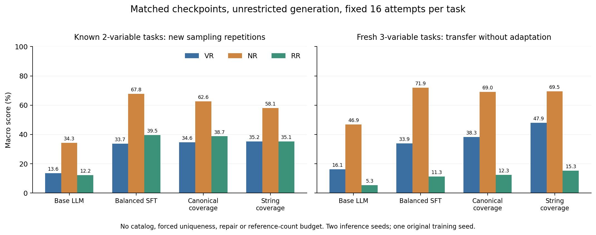
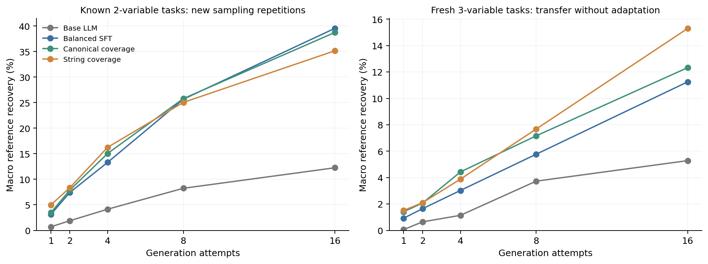

# 固定预算自由生成：重新测试结果

本轮不追求超过某个指标阈值，而是检验原有训练方法的收益和边界。事前协议已在任何新增输出之前固定为提交 `f6ab465`，四组共完成 **4,864次全新LLM生成**，没有使用历史输出重放。

## 1. 主实验：已知两变量题的新采样重复

26道观测题仍是原测试集合；两个推理种子18617、28657为新增采样随机性，不是新训练或全新未见数据。所有模型均使用统一修正过格式问题的相同提示，因此不要把本表与原提示下的旧表直接拼接。

| Method | VR | NR | RR | Recovered classes / task |
|---|---:|---:|---:|---:|
| Base LLM | 13.58% | 34.25% | 12.25% | 1.23 |
| Balanced SFT | 33.65% | 67.79% | 39.54% | 3.60 |
| Canonical Coverage | 34.62% | 62.62% | 38.73% | 3.48 |
| String Coverage | 35.22% | 58.05% | 35.15% | 3.15 |

**事前主要比较：Canonical Coverage减Balanced SFT的RR@16为 -0.81 pp, 95% CI [-4.33, +2.69] pp。区间跨零，本轮未证实覆盖目标相对匹配SFT的额外恢复率收益；这也不是两者等效的证明。**

原始模型与适配器之间的改善包含普通监督微调的收益，不能全部归功于覆盖项。字符串覆盖消融也完整展示，不按最好的指标改选主方法。

## 2. 新三变量迁移题

12道题由固定哈希从官方深度2布尔语法派生观测集合中选出，每个观测数1/2/3各4道。在选择之前没有运行这些题的模型实验；检查点不做迁移训练。参考空间125类，其中91类不在原两变量空间中。它是本项目扩展的任务规则测试，不是论文发布模型分数的复现。

| Method | VR | NR | RR | Recovered classes / task |
|---|---:|---:|---:|---:|
| Base LLM | 16.15% | 46.88% | 5.28% | 1.75 |
| Balanced SFT | 33.85% | 71.88% | 11.25% | 3.88 |
| Canonical Coverage | 38.28% | 69.01% | 12.33% | 4.08 |
| String Coverage | 47.92% | 69.53% | 15.30% | 4.67 |

覆盖模型相对SFT的迁移RR差为 **+1.08 pp, 95% CI [-4.06, +6.17] pp**。区间跨零，本轮未证实覆盖目标相对匹配SFT的额外恢复率收益；这也不是两者等效的证明。 这是次要迁移分析，不能替代主要比较；两种变量数的成绩不混合。

三变量题参考解集大小6–71，固定16次只能覆盖其中有限部分。保留原始RR分母，不重新归一化为更高的“达标率”。12道题中只有1道必须使用原空间之外的结构，其余题也允许旧结构作为部分合法答案，因此这不是全面的未见结构泛化证明。新旧结构命中另有事后诊断，不能替换主要指标。

## 3. 从主结论中移除了什么

| 项目 | 本轮规则 |
|---|---|
| 推理 | 每题16次自由自回归生成，温度1、top-p 1、最多128输出token |
| 方法 | 原始模型＋三个原200步匹配训练检查点，不根据新测试重新选择 |
| 输入 | 只有给定观测和规则，没有参考答案成员、真实K、候选目录或历史答案 |
| 输出 | 不强制去重、不修复、不拒绝重采样；重复和无效回答均计入16次 |
| 数据 | 26道已知两变量题的新采样重复；另有12道新三变量迁移题 |
| 不确定性 | 两个推理种子，先按题平均，再配对bootstrap；只有一个训练种子 |

此前的COVE从33类目录选择，执行器单独使用也达到同分；其99%不能证明LLM原生生成达到99%。此前BACE的唯一率目标由解码规则保证，也不能算模型学到多样性的证据。二者作为历史补充保留，相关结果、未选用的偏好训练和精确求解对照均未删除。

训练本身仍可使用原训练题的合法参考表达式，这属于监督信号；测试提议不读取参考集合。模型runner与评分器分开，后者在全部生成完成后才解析原文。

## 4. 为什么仍是有价值的课程研究

核心设计是将完整回答按官方结构类别聚合概率，再优化有限预算期望覆盖代理。它有与评估指标相关的数学解释，与普通SFT和字符串目标存在形式区别。价值来自任务相关设计和匹配实验，而不是给方法起名或跨过80%。

若主要比较没有胜出，应报告所测试设置中的局限，并分析有限别名概率、与SFT梯度同向以及训练规模的影响。当前结果只支持表中范围，不证明全球首创、跨任务优势或所有训练种子都有效。详见[研究定位](RESEARCH_POSITIONING_ZH.md)和[方法](METHOD.md)。

## 5. 成本与核验

新增生成 **4,864次**；重放0次、候选评分0次、修复0次。生成累计 **18.27分钟**，共享前缀处理另计 **59.64秒**。这些是运行计时，不包含之前的训练、准备、评分和文档时间。相同输出上限不代表严格相同FLOPs，因为实际回答长度不同。

全部4,864条输出、304个完整episode、指标及配对区间通过独立CPU核验；新题固定哈希选择也重新生成比对。原代码和适配器哈希保持一致。

上游枚举与校验仍存在差异：两变量有1个、三变量有3个参考代表写法被空间校验拒绝；这不等于整个类别必然不可达。参考分母不改，所有组使用相同解析/空间门控。参考外校验通过项单列在诊断文件中，主要RR不会给这些项加分。绝对成绩不能直接与论文榜单比较。

## 6. 交付与入口

- [冻结协议](../results/research_audit_v7/protocol.json)与[选题和解释规则](RESEARCH_AUDIT_PROTOCOL_ZH.md)。
- [完整汇总及全部比较](../results/research_audit_v7/summary.json)、[逐题结果](../results/research_audit_v7/episodes.json)。
- [完整压缩输出](../results/research_audit_v7/evidence.jsonl.gz)、[独立核验](../results/research_audit_v7/verification.json)、[成本](../results/research_audit_v7/costs.json)。
- [评分差异诊断](../results/research_audit_v7/scoring_diagnostics.json)、[原始参考写法诊断](../results/research_audit_v7/reference_representation_audit.json)。

CPU复核：`.venv/bin/python scripts/verify_research_audit.py`。小组10分钟视频仍需成员实际参与录制，本研究结果不保证课程分数。

