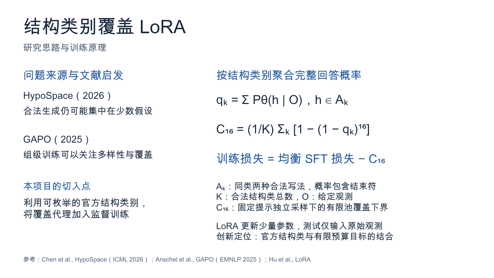
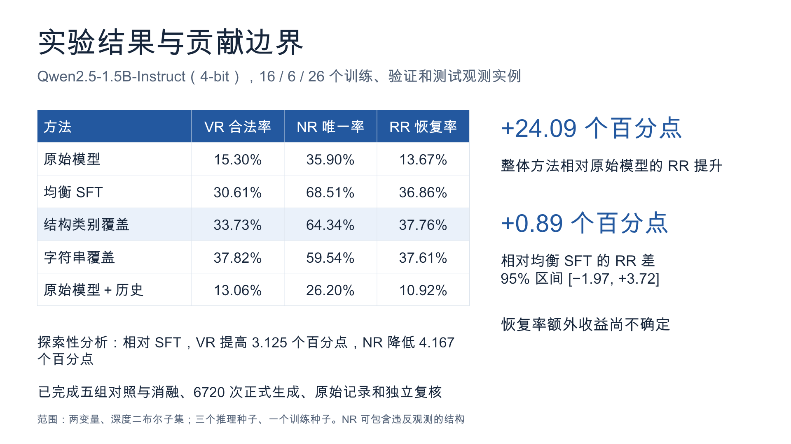

# 个人两页展示：原理与结果

[可编辑 PPTX](personal_method_results.pptx)

1. 原理页：HypoSpace 与 GAPO 文献启发、官方结构类别的概率聚合、有限预算覆盖代理及联合训练损失。LoRA 是实现工具。
2. 结果页：完整五组 VR/NR/RR 对照，区分相对原始模型的整体收益与相对匹配 SFT 尚不确定的恢复率增益。

建议第一页约 65 秒，第二页约 55 秒，总计两分钟。页面信息不需要逐字念出，实际时长需要本人试读。讲稿见[个人两分钟稿](../docs/PERSONAL_TALK_2MIN_ZH.md)。

PPT 中公式为可编辑文本，结果为原生可编辑表格，备注包含讲解提示和来源。实际数据及结论未改变，未新增训练或模型生成。

构建源码为 scripts/build_personal_slides.mjs，需要工作区提供的 @oai/artifact-tool、Presentations 技能工具及 Python 运行库。按运行库发现结果设置 ARTIFACT_NODE_MODULES、PRESENTATION_SKILL_DIR、PRESENTATION_PYTHON，再以相应 Node 运行脚本。已有输出需先另行归档。
