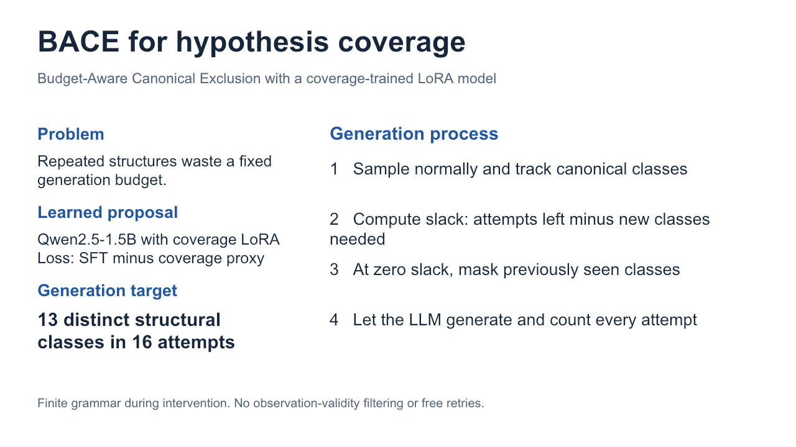
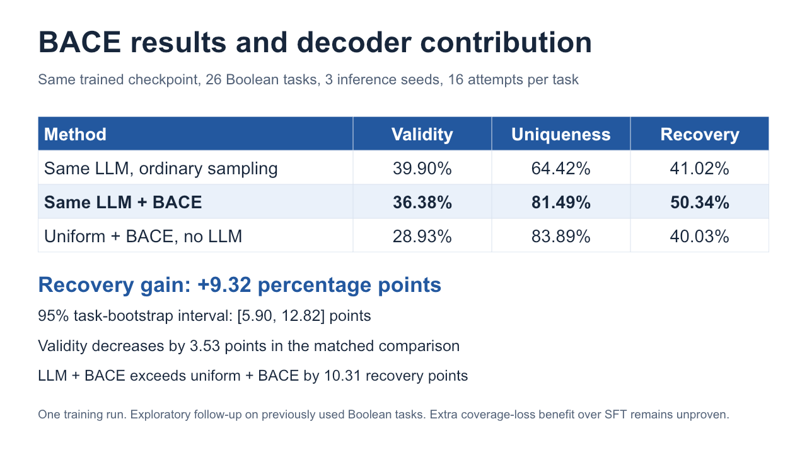
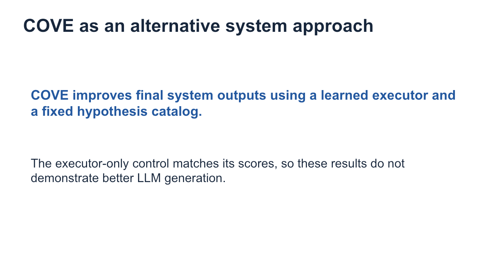

# BACE English presentation

Three slides for the individual project contribution, with no separate cover:

1. BACE principle and generation process.
2. Matched decoder results, including the validity cost and a uniform control.
3. Two sentences on COVE as an alternative system approach, without claiming improved native LLM generation.

The editable deck is saved in the Spaces presentation supplied in the conversation. Export a PowerPoint `.pptx` from its viewer for offline use. The table and all slide text remain editable. This directory contains the final slide previews and reproducible content, not a second exported PPTX.

## Speaking materials

- [Complete English script](English_script.txt): 167 spoken words with numbers written out.
- [Sentence-aligned Chinese correspondence](Script_and_translation.md): both the speaking script and slide text, including the result table.
- [Timing assumptions](timing.json): about 1:59 at 90 words/minute including 8 seconds of pauses, or 2:13 at 80. Rehearse once and read only the script paragraphs.
- [Source content](content.json).

Pronounce BACE as “base”, COVE as “cove”, LoRA as “low rah”, and LLM as three letters. The time estimate counts these pronunciations and splits hyphenated words. Human pacing varies; staying at or above 80 spoken words/minute and within the 8-second pause allowance keeps the planned script below 2:15.

## Evidence and scope

Slide 2 uses the preserved BACE follow-up, not the later free-generation audit. The same trained checkpoint obtains recovery of 41.02% with ordinary sampling and 50.34% with BACE, at the same 16-attempt budget. Validity falls from 39.90% to 36.38%. The uniform BACE control obtains 40.03% recovery. These results isolate decoding; they do not establish extra benefit from the coverage training loss over SFT.

The 26 Boolean tasks had appeared in earlier project experiments, and there is one independent training run per arm. The three seeds are inference repetitions. Sources remain in the English speaker notes and the project reports.

## Rebuilding

`scripts/build_bace_final_slides.mjs` exports live Artifact Session callbacks for the three content slides. Pass `content.json` and the displayed rows derived from `results/canonical_preference_v5/test/summary.json`. Retain the three returned slide IDs to exclude any automatically created blank starter slide. Do not add a cover.

Run `python scripts/build_bace_speaking_pack.py` to rebuild the UTF-8 speaking files. The editable Spaces deck must be updated through its connected Artifact Session if content changes.

